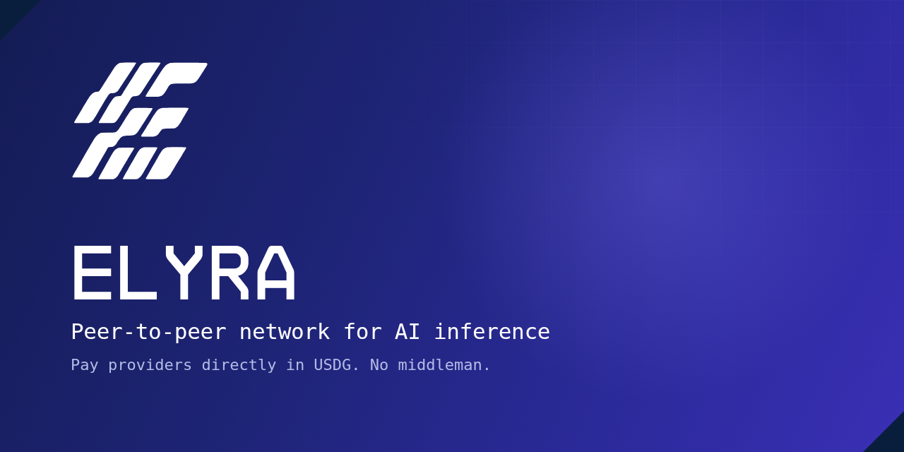
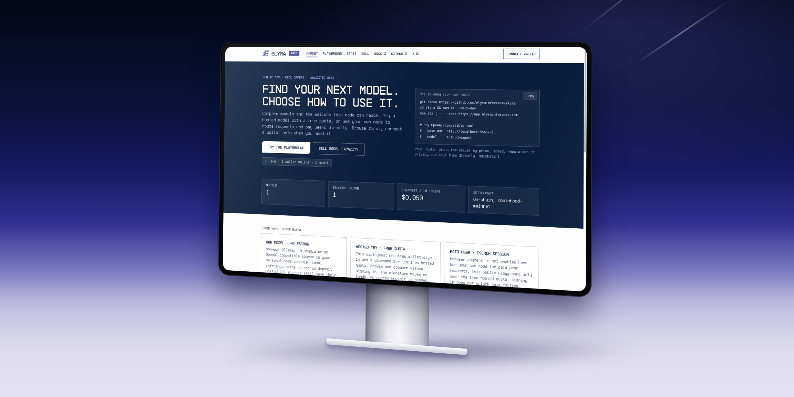
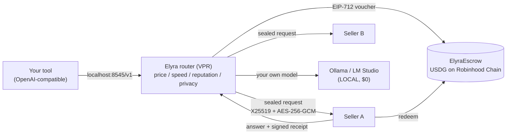

<p align="center"></p>

<h1 align="center">Elyra</h1>

<p align="center"><b>Peer-to-peer AI inference. No middleman between you and the model.</b></p>

<p align="center">
  <a href="https://github.com/elyrainference/elyra/actions/workflows/ci.yml"></a>
  <a href="LICENSE"></a>
  
  <a href="https://elyrainference.com"></a>
  <a href="https://x.com/Elyrainference"></a>
</p>

Run a **Virtual Private Router (VPR)** on your own machine, point any OpenAI-compatible tool at `localhost`, and route each request to a peer by **price, speed, reputation or privacy**. Providers are paid per token, directly, in **USDG** through an escrow contract on **Robinhood Chain**. Anyone can sell capacity, with no approval step and no account.

<p align="center"></p>

## Why

AI access today runs through platforms: you hold an account, a balance and a key with an aggregator or a vendor. The platform sees your prompts, sets the price, takes a margin and can cut you off. People with idle GPUs or spare API quota cannot sell it without becoming a platform themselves.

Elyra replaces that middle layer with a router that **runs on your machine**. The same binary buys and sells. Payment is a signed voucher per request, so a buyer risks at most the balance they put in the escrow.

## How it works



1. Your tool talks to the local router like it talks to OpenAI.
2. The router ranks the sellers it knows (found by gossip, a NAT relay and the on-chain `ElyraRegistry`) and picks one.
3. The prompt travels sealed to the seller's key. The seller answers with an `ed25519`-signed usage receipt.
4. Your node checks the receipt and signs a cumulative payment voucher. The seller redeems it from the escrow.

## What is real today, and what is not

This is an **early, unaudited beta** with a capped mainnet. We label every simulated or self-declared item in the UI (`SIM`, `DEMO`, `CLAIMED`).

| | Status |
|---|---|
| Local router, OpenAI-compatible API, routing by price / speed / reputation / privacy | Working, covered by tests |
| Sealed peer transport, signed receipts, per-token vouchers, escrow settlement | Working on testnet and on mainnet (chain 4663), deposits capped at **$20 USDG per wallet** |
| Selling: multi-source, NAT relay, on-chain provider registry | Working |
| Control panel, public Market / Playground / Sell app, wallet sign-in, browser pay-per-use | Working |
| Independent audit of the escrow contract | **Not done.** The contracts are unaudited |
| TEE-verified sellers | Verifier built and tested against **simulated** attestation tokens. **Never run on real TEE hardware** |
| Large public seller network | **Not yet.** Today the live market has very few sellers. Supply is the open problem |

There is prior art in this space (Morpheus, Bittensor, Akash and others, compared honestly in [`docs/LANDSCAPE.md`](docs/LANDSCAPE.md)). Elyra does not claim to be first. The bet is a router that is identical for buying and selling, per-token stablecoin vouchers, and buyer-pinned attestation.

Requirement-by-requirement status lives in [`docs/SDD.md`](docs/SDD.md) and the verification log in [`docs/STATUS.md`](docs/STATUS.md). Read both before relying on anything.

## $ELYRA token

`$ELYRA` is live on Robinhood Chain.

- **Contract:** [`0x42cc3f36bb20481378bc0d84ebdfd4fe8f17fbf5`](https://robinhoodchain.blockscout.com/token/0x42cc3f36bb20481378bc0d84ebdfd4fe8f17fbf5)
- **Name / symbol / supply:** Elyra Inference / ELYRA / 1,000,000,000 (18 decimals), read from the contract.
- **Not needed to use Elyra.** Inference is paid in USDG. You do not need the token to buy or sell.
- **Staking, rewards and free requests for stake are not live.**
- Always verify the address on the explorer. Nothing here is financial advice. Details: [`docs/TOKEN.md`](docs/TOKEN.md).

## Quick start (local, 2 minutes)

Requires Node.js 20 or newer. Runtime dependency: `ethers` only. No build step.

```bash
git clone https://github.com/elyrainference/elyra.git
cd elyra
npm ci --omit=dev
npm start
```

| What | URL |
|---|---|
| Landing | http://localhost:8545/ |
| Control panel | http://localhost:8545/app/ (a live node you can try: https://app.elyrainference.com) |
| OpenAI-compatible endpoint | `http://localhost:8545/v1` |

```bash
curl http://localhost:8545/v1/chat/completions \
  -H 'content-type: application/json' \
  -d '{"model":"auto:cheapest","messages":[{"role":"user","content":"hello"}]}'
```

Without a real model attached, the router shows simulated peers (labelled `SIM`). To serve a real model, run [Ollama](docs/OLLAMA.md) and point the node at it.

## How it works in practice

### Peer-to-peer vs. hosted sources
- **Your own models (`LOCAL` / `REMOTE`):** attach Ollama, LM Studio, or any OpenAI-compatible server on your machine (`LOCAL`, `$0`, private). If the model runs on another machine reached through an SSH tunnel or VPN, mark it `remote` so it is labelled `REMOTE` and never treated as private.
- **Peer-to-peer sellers (`LIVE`):** other Elyra nodes reached directly over HTTPS or through a NAT relay (`ELYRA_RELAY_URL`, no port forwarding). Prompts travel in a sealed `X25519 + AES-256-GCM` envelope, the seller returns an `ed25519`-signed usage receipt, and payment settles per token in **USDG** on Robinhood Chain through `ElyraEscrow`.
- **Hosted APIs (`HOSTED · CLEAR`):** you can also attach your own API key from OpenRouter, OpenAI, Groq, or Together to your local router. Hosted models are ranked by their published per-model prices (never treated as free), billed outside the chain by that provider under your account, **never** re-shared with peers or listed on the public market, and **never** counted as peer-to-peer or TEE/private. Measure any node or `/models` endpoint with `npm run catalog:stats` (for example, OpenRouter's 460 raw entries deduplicate to **339 unique canonical models across 57 vendors**, all `hosted`).

### Paying for requests (node wallet & browser pay-per-use)
- **Through your own node (`localhost:8545/v1`):** your node generates its own wallet in `.elyra/` (encrypted at rest when `ELYRA_PASSPHRASE` is set) and signs cumulative EIP-712 payment vouchers automatically after verifying each receipt. Fund the node's escrow from MetaMask, Rabby, or Coinbase Wallet in **Payments** (`depositFor(nodeAddress)`).
- **Pay-per-use in the browser (`ELYRA_PUBLIC_PAY=1`):** on a public node that enables browser session pay, visitors can pay peer sellers per token without installing a node. Your browser generates a local session key, you fund that session address from your wallet (`depositFor(sessionAddress)`), and your browser verifies each receipt against the accepted price ceiling before signing the voucher. The public node only relays messages and never holds your funds or keys. When withdrawing, the browser leaves enough deposit in escrow (`deposit - owed`) to cover any vouchers already signed that sellers have not redeemed yet.
- **Per-wallet deposit cap:** while `ElyraEscrow` is unaudited, the router, seller credit gate (`402 deposit_cap_exceeded`), wallet fund helper, and browser session pay enforce a configurable per-wallet escrow cap (default **$20 USDG**, `maxDepositUsd`).

### Privacy and TEE limits
- **Sealed transport is not TEE:** encrypting `/p2p/infer` hides prompts and completions from network observers and relays, **not** from the machine running the model.
- **What counts as private:** `teeOnly` and `auto:private` accept only a `LOCAL` model on your own machine/LAN or a hardware-attested `TEE · VERIFIED` seller. Self-declared `CLAIMED` sellers, SSH-tunnelled `REMOTE` GPUs, and `HOSTED · CLEAR` APIs are excluded.
- **Current TEE status:** the Google Confidential Space attestation verifier (`router/tee.mjs`) is built, requires the seller's container `image_digest` to be in **your** pinned trust list, and is tested against simulated Google tokens, but **has not yet been run on a real Confidential Space VM** (milestone M1 in [`docs/TEE.md`](docs/TEE.md)). Ordinary VPSs cannot produce hardware attestations.

## Documentation

| Guide | For |
|---|---|
| [Quickstart](docs/QUICKSTART.md) | Five steps from zero to a real answer from your own model |
| [How it works](docs/CONCEPTS.md) | Routing, peers, receipts, vouchers, and what is real today |
| [Install](docs/INSTALL.md) | Local, Linux server (systemd), upgrades, uninstall |
| [Ollama](docs/OLLAMA.md) | Run a real local or SSH-tunnelled GPU model behind Elyra |
| [Usage](docs/USAGE.md) | The OpenAI endpoint, routing models (`auto:*`), headers |
| [Control panel](docs/PANEL.md) | Every view of `/app/`, labels, typical flows, the live public app (Market, Playground, Sell) |
| [$ELYRA token](docs/TOKEN.md) | Contract address, what the token is and is not used for |
| [Wallet and USDG](docs/WALLET.md) | Node wallet, browser pay-per-use session keys, `$20` deposit cap, withdrawals |
| [Provider guide](docs/PROVIDER.md) | Sell capacity (multi-source, NAT relay), payment flow, risk controls, TEE limits |
| [Control API](docs/API.md) | `/api/*` reference |
| [Remote admin](docs/REMOTE-ADMIN.md) | Opt-in: the real panel on your own hostname behind a login (token or wallet), plus `/pub/*` |
| [Run in Docker](docs/DOCKER.md) | `docker compose up` on Linux, next to your own Ollama |
| [Run it in production](docs/OPERATIONS.md) | Systemd sandboxing, monitoring, daily backups, non-disruptive restore drill |
| [Mainnet runbook](docs/MAINNET.md), [Registry](docs/REGISTRY.md), [Auth](docs/AUTH.md) | Capped mainnet beta, on-chain discovery, wallet sign-in threat model |
| [Private inference (TEE)](docs/TEE.md) | Confidential Space attestation verifier, trust list, limits, milestone M1 |
| [FAQ](docs/FAQ.md), [Glossary](docs/GLOSSARY.md) | Common questions, catalog counting rules (`catalog:stats`), troubleshooting |
| [Configuration](docs/CONFIGURATION.md) | Every CLI flag and `ELYRA_*` variable |
| [Deploy the docs to Cloudflare](docs/DEPLOY-CLOUDFLARE.md) | Docs bundle on Cloudflare Pages |
| [Architecture](docs/ARCHITECTURE.md), [Protocol](docs/PROTOCOL.md), [Decisions](docs/DECISIONS.md) | How it works and why |
| [Software design & status (SDD)](docs/SDD.md) | Authoritative requirement-by-requirement status (`DONE` / `PARTIAL` / `NOT DONE`) |
| [Verification log (STATUS)](docs/STATUS.md) | Testnet addresses, tx hashes, security review findings, ops drill records |
| [Security policy](SECURITY.md) | Reporting vulnerabilities, trust model |

Maintainers and coding agents: start with [`AGENTS.md`](AGENTS.md).

## Develop

```bash
npm ci                     # all deps
npm test                   # behaviour tests: two real nodes over HTTP, security, load/abuse, remote admin, routing, panel modules, TEE with a simulated Google
npm run chain:install      # hardhat + local solc, for the on-chain settlement test and contract tests
npm run chain:test         # contract unit tests
npm run catalog:stats      # count deduplicated models and vendors across configured sources or --openrouter
```

See [CONTRIBUTING.md](CONTRIBUTING.md).

## License

[MIT](LICENSE). The escrow contract sources are MIT as well and are **unaudited**; do not put more funds behind them than you can lose. Vendor logos and the bundled wallet library keep their own licenses: see [`THIRD_PARTY.md`](THIRD_PARTY.md).

## Community

- Website: [elyrainference.com](https://elyrainference.com) · Live app: [app.elyrainference.com](https://app.elyrainference.com)
- X: [@Elyrainference](https://x.com/Elyrainference)
- Bugs and ideas: [issues](https://github.com/elyrainference/elyra/issues). Vulnerabilities: see [SECURITY.md](SECURITY.md), do not open a public issue.
