# Architecture

```mermaid
flowchart LR
  T[Your tool<br/>OPENAI_BASE_URL=localhost:8545/v1] --> V1[/v1 chat/]
  subgraph VPR[Your VPR node]
    V1 --> C[chat&#40;&#41;<br/>plan → rank → exec → record]
    C --> R[policy.mjs<br/>filter + score]
    C --> U[Self upstreams<br/>Ollama / API / demo]
    C --> L[(state.json<br/>ledger, routes, stats)]
    UI[panel/ panel] --> API[/api/*<br/>loopback only/]
    API --> C
  end
  C -- POST /p2p/infer --> P[Peer node<br/>serve&#40;&#41;]
  P --> PU[Provider upstream]
  P -- signed receipt --> C
  C -. gossip /p2p/hello .- P
  C --> S[Simulated peers<br/>catalog.mjs]
```

## Request path (consumer)

1. `router/http/v1.mjs` parses body → `node.chat(body, sink, ctl)`.
2. `plan(model)` → `candidates()` (self upstreams + online real peers + simulated catalog) → `rank()` with the stored policy; `auto*` hides `explicitOnly` candidates (demo engine) unless nothing else exists.
3. For the top 3: `exec()` by kind. `self`/openai → `fetch` passthrough with usage sniffing; `self`/demo and `sim` → `demo.mjs`; `peer` → `execPeer()` POST `/p2p/infer`, verifies the receipt.
4. First candidate that returns starts the response (`x-elyra-*` headers); no failover after that.
5. After the stream: `record()` (reputation/speed EWMA), push `routes` entry, push `ledger` spend (non-self, ok only), `save()` (debounced 1.5 s, atomic rename).

## Request path (provider)

`/p2p/infer` → `serve()`: provider enabled? consumer id matches key hash? model offered? `maxPrice ≥ price`? under concurrency cap? → `exec()` against the chosen upstream → build receipt from upstream `usage` → sign → append `earn` ledger entry and `in` route → return `{completion, receipt}` or SSE + trailing `event: receipt`.

## State (`.elyra/state.json`, plus `identity.json`)

`name, policy{weights,teeOnly,maxPrice}, upstreams[], provide{enabled,upstreamId,price,tee,models[],maxConcurrent}, peers{id→{url,pubkey,name,models,online,rtt,fails}}, ledger[], routes[], stats{key→{ok,fail,tps,lat}}, batches[], wallet{funded}, settings{demoNetwork}`. Caps: 2000 routes, 5000 ledger entries. Balance = `funded − Σ spend`.

## Candidate fields

`key, kind(self|peer|sim), peerId, peerName, model, logo, price($/MTok), tps, reputation(0–5), tee(none|claimed|demo), private, privacyScore, simulated, explicitOnly`.

Scoring (`router.rank`): min-max normalise price (inverted) and speed across the filtered set, reputation/5, privacy score (self 1, TEE 0.8, clear 0); weighted average; tie → cheaper. Reputation for real routes: `5·(ok+3)/(ok+fail+3.5)`.

## Settlement (chain mode)

`chain.configured()` = ethers + artifact + valid escrow address. Consumer: `approve` + deposit USDG to `ElyraEscrow` (gas in ETH); after each verified receipt `issueVoucher()` signs cumulative `prev + amountWei` and pushes it to the provider (`/p2p/voucher`, also attached to the next request). Spendable balance = deposit − Σ(cumulative − claimed), refreshed every 10 s. Provider: tracks `vouchersIn[consumer] = {cumulative, sig, owedWei, redeemed}`; `settle()` calls `redeem` per consumer, marks earn entries settled FIFO up to the redeemed wei, records a batch with the tx hash. State additions: `chain{network,rpcUrl,chainId,escrow}`, `vouchersOut`, `vouchersIn`.

## Observability

`router/obs.mjs`: JSON-lines logs (`LOG_FORMAT=json|text`, `LOG_LEVEL`; default JSON when not a TTY), Prometheus text at `GET /metrics` (loopback only), `GET /healthz` (public: ok, version, protocol, uptime, peers). Metrics: `elyra_http_requests_total`, `elyra_route_total{result,kind}`, `elyra_tokens_total{dir}`, `elyra_receipts_rejected_total{reason}`, `elyra_vouchers_issued_total`, `elyra_redeem_total{result}`, `elyra_peer_events_total`, gauges for peers online, provider in-flight, spendable balance, chain mode, unredeemed USD. Logs and metrics carry metadata only, never prompts, completions or keys (tested).

## Security model

| Surface | Reachability | Controls |
|---|---|---|
| `/api/*`, `/v1/*` | loopback only | remote address check, `Host` allow-list (DNS-rebinding), `Origin` must be localhost, JSON content type, CORS only for localhost origins |
| `/p2p/*` | whatever `--host` binds | sealed-only infer, body limit 8 MB, price quote check, concurrency cap, per-consumer rate limit, deny list, consumer id = hash(pubkey), credit limit + escrow check |
| static | same listener | no dot segments, no `router/`, no traversal |
| keys | `.elyra/identity.json`, `.elyra/wallet.json` (0600 on POSIX) | never served, never sent; plaintext at rest |

## Why these choices
See `DECISIONS.md`.
