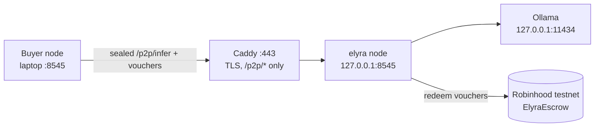

# Running Elyra on a VPS (seller node with Ollama)

Audience: the operator's agent on a fresh Linux server. Written 2026-11-06 on Windows; **commands below were not executed on a VPS from this project**. Check each against the distro's current docs, and report what differed in `docs/STATUS.md`.

What you get: a **seller** node (non-TEE) that serves a model from Ollama on the same machine, announces itself to seeds, and is paid in testnet USDG through `ElyraEscrow`. It is an honest "normal seller": the VPS operator can see prompts, so it must NOT be labelled TEE (the node only claims TEE inside Confidential Space).



## 0. Sizing and cost sanity
| Goal | Machine | Models that fit (q4, rough) |
|---|---|---|
| Prove the network works | 2 vCPU, 4 GB RAM, 40 GB disk | `qwen2.5:0.5b`, `llama3.2:1b` (slow but real) |
| Usable small seller | 4 vCPU, 16 GB RAM, 80 GB disk | `llama3.2:3b`, 7-8B models (a few tokens/s on CPU) |
| Fast / large | rented GPU (RunPod, Vast.ai, Lambda, Hetzner GPU...) | 8B to 70B depending on VRAM |

Rule: price per MTok must exceed your rental cost per MTok actually served. Start on the cheap CPU box; do not rent a GPU before a buyer exists. Disk sizes are rules of thumb, not measured here.

## 1. Server prep
- Ubuntu 24.04 LTS (or Debian 12). Create a non-root user `elyra`; SSH keys only; firewall allows 22, 80, 443 and nothing else (8545 and 11434 stay on 127.0.0.1).
- Node 22: install from NodeSource or `nvm`. The project needs Node >= 20 and one runtime dep (`ethers`).

## 2. Ship the project (never ship secrets)
From the Windows machine:
```
tar --exclude=.elyra --exclude=.elyra-b --exclude=node_modules --exclude=tools/brand/node_modules --exclude=contracts/node_modules --exclude=contracts/cache -czf elyra.tgz .
scp elyra.tgz elyra@SERVER:/home/elyra/
```
`.elyra*/` holds node identity and a **wallet private key**: never copy them and never commit them. The VPS node generates its own identity and wallet on first boot.
On the server: `mkdir -p ~/elyra && tar -xzf elyra.tgz -C ~/elyra && cd ~/elyra && npm ci --omit=dev` then `npm test` (47 tests; the on-chain one skips without `contracts/node_modules`, that is fine).

## 3. Ollama
```
curl -fsSL https://ollama.com/install.sh | sh          # installs a systemd service on 127.0.0.1:11434
ollama pull llama3.2:3b                                 # pick one model that fits RAM/disk
curl http://127.0.0.1:11434/v1/models                   # must list it
```
Small disk? Put models elsewhere: set `OLLAMA_MODELS=/mnt/bigdisk/ollama` in the Ollama service environment. Keep Ollama on loopback; never expose 11434.

## 4. Node as a service
`/etc/elyra/env` (chmod 600, owner root):
```
ELYRA_PASSPHRASE=<long random, store it in your password manager: without it the identity/wallet cannot be opened>
ELYRA_PUBLIC_URL=https://seller.example.com
ELYRA_NETWORK=robinhood-testnet
ELYRA_ESCROW=0xe9dA82E45D8CbF84A633a0B0e46e12D2A9288092
ELYRA_UPSTREAM_URL=http://127.0.0.1:11434/v1
ELYRA_UPSTREAM_NAME=ollama
ELYRA_PROVIDE=1
ELYRA_PROVIDE_PRICE=0.20
ELYRA_PAYOUT=<address you control that receives swept USDG>
ELYRA_SEEDS=https://<another-node>,https://<another-node-2>
```
`/etc/systemd/system/elyra.service`:
```
[Unit]
Description=Elyra node
After=network-online.target ollama.service
[Service]
User=elyra
WorkingDirectory=/home/elyra/elyra
EnvironmentFile=/etc/elyra/env
ExecStart=/usr/bin/node router/server.mjs --host 127.0.0.1 --port 8545 --data /var/lib/elyra --name seller-1 --no-demo
Restart=on-failure
KillSignal=SIGTERM
TimeoutStopSec=30
StateDirectory=elyra
[Install]
WantedBy=multi-user.target
```
`systemctl enable --now elyra`. SIGTERM makes the node redeem outstanding vouchers (bounded 20 s) before exit, so keep `TimeoutStopSec` >= 30.
`--no-demo` removes the simulated peers; a real seller must not show demo data.

## 5. TLS and exposure (the one security-critical step)
Only `/p2p/*` and `/healthz` may be reachable from the internet. `/api` (control: keys, wallet, upstream keys), `/v1` and `/metrics` are loopback-only inside the node, but do not rely on one guard: do not forward them at all. Caddy example:
```
seller.example.com {
  @p2p path /p2p/* /healthz
  handle @p2p { reverse_proxy 127.0.0.1:8545 }
  respond 404
}
```
DNS A record -> the VPS; Caddy gets the certificate automatically. Without a domain, a `cloudflared` quick tunnel works for tests (it was used on this project, see `docs/STATUS.md`); set `ELYRA_PUBLIC_URL` to the tunnel URL.
`/p2p/infer` bodies are sealed to the seller's key, so TLS is for integrity/availability and hiding metadata, not the only protection. Still use it.

## 6. Fund and verify
1. Control panel from your laptop through an SSH tunnel: `ssh -L 9545:127.0.0.1:8545 elyra@SERVER`, open `http://localhost:9545/app/`. (Host must be `localhost`; that is why a tunnel works and a public hostname does not.)
2. Payments shows the node wallet address. Send it **testnet ETH** for gas (faucets listed in `router/chain.mjs` `FAUCETS`; login required, a human step).
3. `curl https://seller.example.com/p2p/hello` -> signed JSON with node id, models, price.
4. From the buyer (laptop node A): Network -> add peer `https://seller.example.com`. It should appear online with reputation 0 and the Ollama model.
5. On the buyer: Payments -> Mint test USDG -> Deposit into escrow; then route a request: `curl localhost:8545/v1/chat/completions -d '{"model":"auto:cheapest",...}'`. Expect a real model answer, a receipt, and after settlement an on-chain redeem (explorer link in Payments). Provider credit limit defaults to $0.50 and auto-redeems at $0.25 of unredeemed vouchers.

## 7. Operations
- Logs: `journalctl -u elyra -f` (JSON lines; never contain prompts or keys). Metrics: `curl 127.0.0.1:8545/metrics`.
- Backups: `/var/lib/elyra` (encrypted with the passphrase) is the identity and wallet. Losing it loses the node's reputation and any unswept earnings. Sweep earnings to `ELYRA_PAYOUT` regularly.
- Update: stop service (it redeems), replace code, `npm ci --omit=dev`, `npm test`, start. Bump rules for the wire protocol are in `AGENTS.md`.
- Security hygiene: unattended-upgrades, fail2ban or equivalent for SSH, no password SSH, nothing else listening (`ss -ltnp`).

## 8. Things that will bite
- Gossip refuses private/LAN URLs unless started with `--allow-private-peers` (SSRF guard). Public URLs only; operator-typed peers are the exception.
- A seller behind NAT with no public URL cannot be reached (no relay yet). Use a VPS, tunnel or port forward.
- `mainnet` needs `--allow-mainnet` and real USDG: do not enable on this server until the contract audit and TEE milestone are done (`ROADMAP.md`).
- Mock USDG (testnet) is minted by anyone; it has no value. The escrow address above is the 2026-11-06 deployment on Robinhood Testnet.
- The "600+ models" on the landing page is a launch target. This node serves exactly the models Ollama lists.

## 8b. Findings from the first real run (2026-11-05, Ubuntu 22.04, CPU)

- Install Node to a system path (`/opt/node` from the official tarball, checksum verified). Node under `/root` is unreadable for user `elyra`; the unit fails immediately (exit 203).
- Ollama installer works as documented; first completion is a cold model load (82 s with RAM nearly full), then about 1 s. See `docs/OLLAMA.md`.
- Providing to the network (sections 5-6) was **not** exercised on this run. Step by step guides: `docs/INSTALL.md`, `docs/OLLAMA.md`.

## 9. Acceptance checklist for the agent
- [ ] `systemctl status elyra` active, survives `reboot`.
- [ ] `curl https://<domain>/p2p/hello` valid; `curl https://<domain>/api/status` returns 404 (not 403, not data).
- [ ] Peer added from another node; a real completion returned; receipt verified; at least one voucher redeemed on-chain (tx hash recorded in `docs/STATUS.md`).
- [ ] Nothing besides 22/80/443 listening publicly.
- [ ] Findings that differ from this document are written back here.
